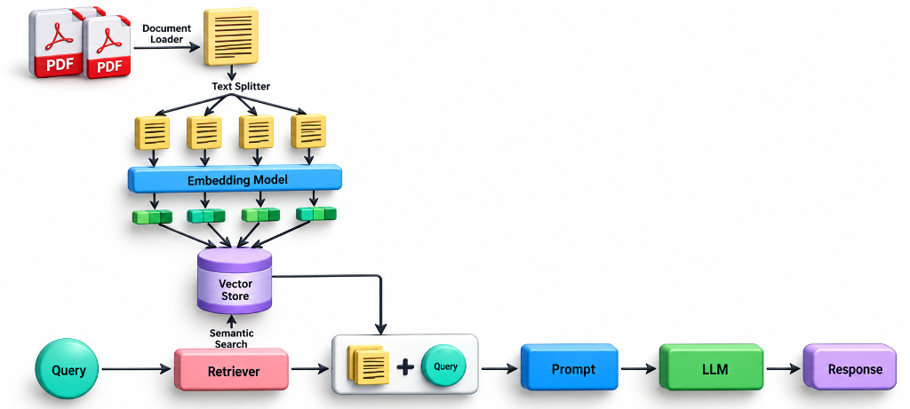
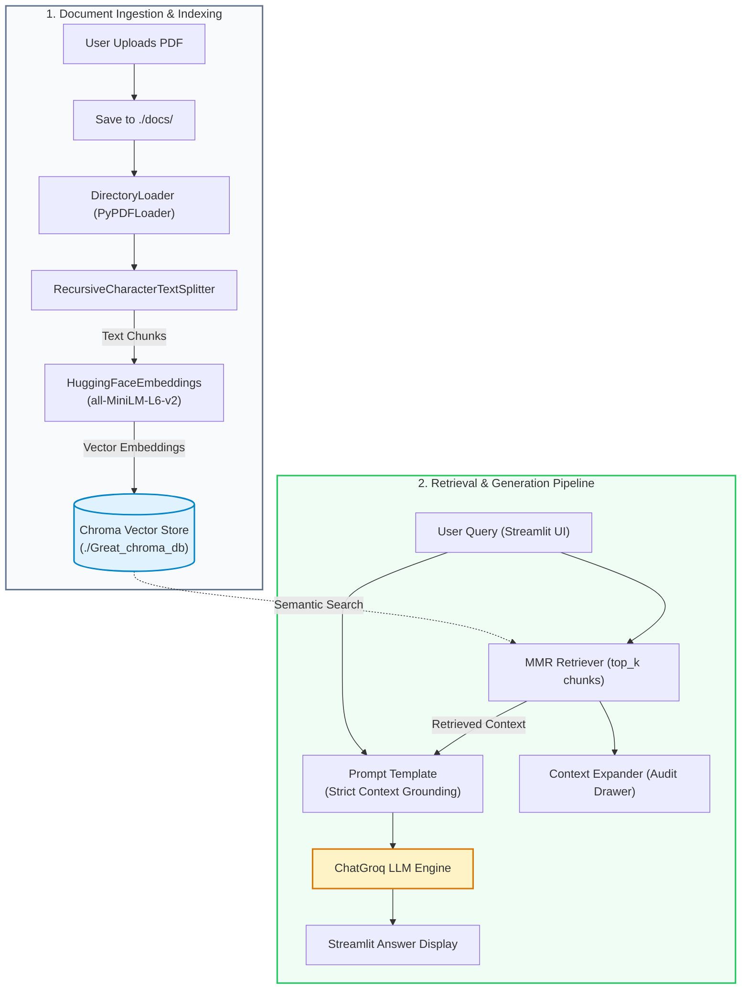

# 📄 PDF RAG Chatter

A high-performance **Retrieval-Augmented Generation (RAG)** application built with **Streamlit**, **LangChain**, **ChromaDB**, and **Groq**. This application allows users to upload PDF documents, extract and index their contents into a local vector database, and perform context-grounded Q&A with ultra-fast LLM inference.

---

## 📌 Features

- **Document Ingestion**: Upload PDF documents directly via the UI; documents are automatically stored and parsed using [`PyPDFLoader`](rag.py).
- **Dynamic Chunking**: Configurable chunk size and chunk overlap using [`RecursiveCharacterTextSplitter`](rag.py) with real-time chunk counter.
- **Local Dense Embeddings**: Generates 384-dimensional dense vector representations locally using `sentence-transformers/all-MiniLM-L6-v2` (cached with Streamlit resource caching).
- **Persistent Vector Store**: Built-in persistence using [ChromaDB](https://www.trychroma.com/) with automated collection synchronization.
- **MMR (Maximal Marginal Relevance) Retrieval**: Reduces redundancy and maximizes semantic diversity in retrieved document passages.
- **Ultra-Fast LLM Inference**: Powered by [Groq](https://groq.com/) for near-instantaneous streaming and inference.
- **Strict Grounding**: Prompt engineering ensures the model answers strictly using retrieved context, mitigating hallucinations.
- **Context Transparency**: Expandable inspection drawer showing the exact context passages provided to the model for full auditability.

---

## 🏗️ Architecture & Workflow

The system follows a standard two-phase RAG pipeline: **Ingestion & Indexing Phase** (offline/upload-time) and **Query & Retrieval-Augmented Generation Phase** (runtime).

<p align="center">
  
</p>



### Detailed Pipeline Flow

1. **Upload & Persistence**: 
   - Uploaded PDF files are saved to the `./docs` directory.
   - `DirectoryLoader` reads all `.pdf` files from disk and parses text along with page metadata.
2. **Text Splitting**:
   - `RecursiveCharacterTextSplitter` segments large documents into smaller semantic chunks based on customizable `chunk_size` and `chunk_overlap` sliders.
3. **Embedding & Vector Storage**:
   - Text chunks are encoded into numerical vectors using Hugging Face's `all-MiniLM-L6-v2`.
   - Embeddings and metadata are indexed into a local persistent Chroma vector store directory (`./Great_chroma_db`).
4. **Maximal Marginal Relevance (MMR) Retrieval**:
   - When a user inputs a question, the retriever computes similarity scores against stored chunks.
   - MMR optimizes for both query relevance and novelty, avoiding redundant chunks.
5. **Augmented Generation**:
   - The retrieved passages are formatted into a context block inside a specialized prompt template.
   - The prompt instructs the LLM to answer *only* from the provided context or declare insufficient information.
   - `ChatGroq` generates the final grounded response and presents both the answer and the source snippets to the user.

---

## 🛠️ Tech Stack

| Component | Technology | Description |
| :--- | :--- | :--- |
| **Frontend UI** | [Streamlit](https://streamlit.io/) | Interactive web UI with sidebar sliders and expanders |
| **Orchestration** | [LangChain](https://www.langchain.com/) | RAG pipeline, loaders, splitters, retrievers, and prompt templates |
| **Embeddings** | [Hugging Face](https://huggingface.co/) | `sentence-transformers/all-MiniLM-L6-v2` |
| **Vector Database** | [ChromaDB](https://docs.trychroma.com/) | Local persistent vector database |
| **LLM Inference** | [Groq](https://groq.com/) | High-speed LLM acceleration endpoint |
| **Document Loader** | [pypdf](https://pypi.org/project/pypdf/) | PDF parsing and text extraction |

---

## 📂 Project Structure

```
RAG_PROJECT/
├── docs/                       # Local directory where uploaded PDFs are stored
│   └── NEW_RESUME.pdf          # Sample uploaded document
├── Great_chroma_db/            # Persistent Chroma vector database files
├── .env                        # Environment variables (e.g., GROQ_API_KEY)
├── rag.py                      # Main Streamlit application and RAG pipeline
└── README.md                   # Project documentation
```

---

## ⚙️ Configuration & Parameters

The sidebar allows dynamic tuning of the RAG engine without altering code:

- **Set Chunk Size** (`20` – `1000`, default `500`): Maximum number of characters in each chunk.
- **Set Chunk Overlap** (`10` – `500`, default `100`): Number of overlapping characters between consecutive chunks to preserve contextual boundaries.
- **Set Top k Results** (`1` – `10`, default `4`): Number of most relevant and diverse document passages to retrieve for generation.
- **Set Temperature** (`0.00` – `1.00`, default `0.20`): Degree of LLM randomness. Lower values guarantee higher determinism and strict factual grounding.

---

## 🚀 Getting Started

### 1. Prerequisites

- Python 3.10+ installed.
- A free [Groq Cloud API Key](https://console.groq.com/).

### 2. Clone / Setup Repository

Navigate to your project root:

```bash
cd "c:/Users/User/OneDrive/Desktop/The ultimate RAG/RAG_PROJECT"
```

Activate your virtual environment:

**Windows (PowerShell):**
```powershell
.\venv\Scripts\Activate.ps1
```

**Windows (cmd.exe):**
```cmd
venv\Scripts\activate.bat
```

### 3. Install Dependencies

Ensure all required libraries are installed:

```bash
pip install streamlit langchain langchain-community langchain-core langchain-text-splitters langchain-huggingface langchain-chroma langchain-groq sentence-transformers chromadb pypdf python-dotenv
```

### 4. Configure Environment Variables

Create or update the `.env` file in the project root:

```env
GROQ_API_KEY=gsk_your_groq_api_key_here
```

### 5. Run the Application

Launch the Streamlit web server:

```bash
streamlit run rag.py
```

Open your browser at `http://localhost:8501`.

---

## 💡 How to Use

1. **Upload Document**: Use the file uploader in the main panel to upload a PDF file.
2. **Tune Engine Settings**: Adjust chunk size, overlap, top-k, and temperature in the sidebar if desired.
3. **Ask Questions**: Type your query in the prompt box (e.g., *"Summarize the candidate's work experience"* or *"What skills are listed?"*).
4. **Inspect Source Context**: Expand the **"Retrieved docs:"** drawer below the answer to audit the exact excerpts used by the LLM.

---

## 🔒 Grounding & Safety

The application utilizes a restrictive system prompt:
```text
You are a helpful assistant.
Answer ONLY from the provided context.
If the context is insufficient, just say you don't know.
```
This minimizes hallucination risk by instructing the model not to extrapolate or infer beyond facts present in the uploaded PDF.
